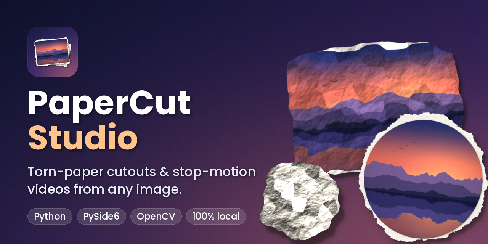
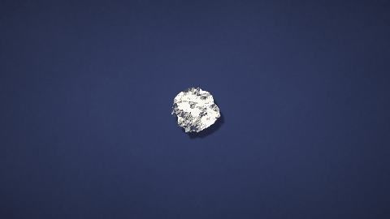
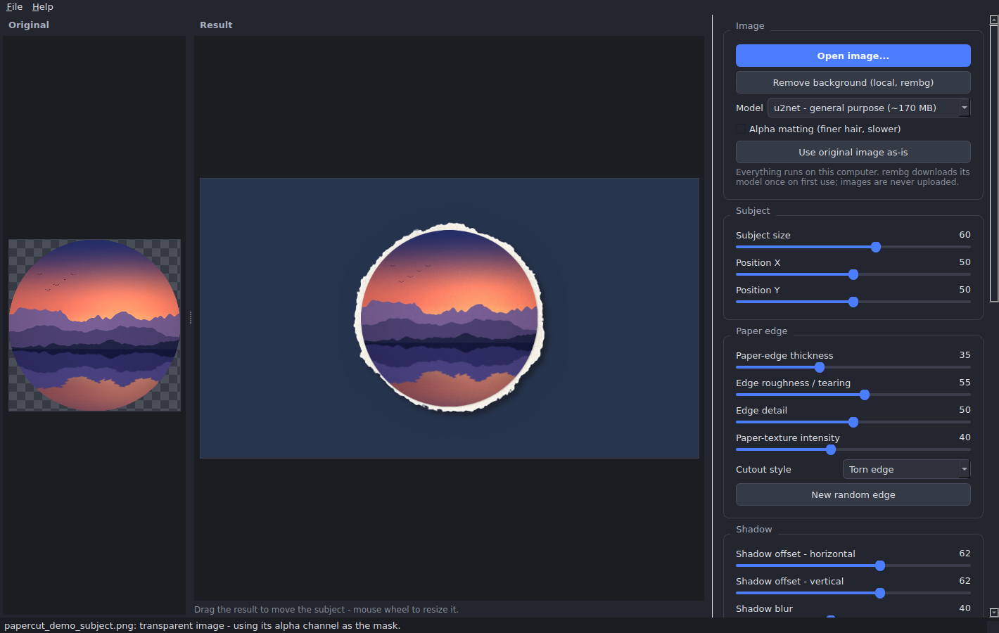

<p align="center">
  
</p>

<p align="center">
  <a href="LICENSE"></a>
  
  
  
  <a href="https://github.com/anasMsaedwi/papercut-studio/actions/workflows/ci.yml"></a>
</p>

-----------------------
<p align="center">
  <a href="https://www.youtube.com/watch?v=-gy-wOEYXPA&pp=ygUT2KfZhtizINiz2LnYr9in2YjZig%3D%3D"></a><br>
  <sub><b>▶ Watch the video</b> (2½ minutes, opens on YouTube)</sub>
</p>

<p align="center">
  <a href="#see">👀 See</a> ·
  <a href="#features">✨ Features</a> ·
  <a href="#install">🚀 Install</a> ·
  <a href="#use">🎬 Use</a> ·
  <a href="#transition">📜 Transition</a> ·
  <a href="#fix">🛠 Troubleshoot</a> ·
  <a href="#credits">🙏 Credits</a> ·
  <a href="LICENSE">License</a>
</p>

<p align="center">
  <a href="LICENSE"></a>
  
  
  
  <a href="https://github.com/anasMsaedwi/papercut-studio/actions/workflows/ci.yml"></a>
</p>

---------------------
# PaperCut Studio

Turn any image into a **torn-paper / paper-cutout** picture or a **stop-motion video**.
Import a picture, cut out the subject, add an irregular paper edge, paper texture and a soft shadow,
preview it live, and export **PNG** (transparent) or **MP4** - all **100% locally**, no cloud, no uploads.

<p align="center">
  
  <br><sub>The built-in unfold / crumple transition (stop-motion, 12 poses per second)</sub>
</p>

## Features

- **Cut-outs:** local background removal (optional rembg), smooth / scissor-cut / torn edges, adjustable thickness, roughness and detail.
- **Paper look:** grain, fibres and mottling, a lighter torn rim, a contact shadow and a soft drop shadow.
- **Animation:** subtle jitter, stop-motion, floating, bounce, gradual reveal - seeded, so edges never flicker.
- **Unfold / crumple transition:** a crumpled sheet unfolds to reveal your picture, then crumples away (preview + export).
- **Export:** PNG with alpha, H.264 MP4 (16:9 or 9:16, 720p / 1080p, 24 / 30 FPS, 3-10 s), green chroma-key option.
- **Responsive UI:** every heavy job runs in a background thread; exports can be cancelled.

<p align="center">
  
</p>

## Quick start

```bash
git clone https://github.com/anasMsaedwi/papercut-studio.git
cd papercut-studio
python -m venv .venv                      # Windows: py -3.12 -m venv .venv
source .venv/bin/activate                 # Windows: .venv\Scripts\Activate.ps1
python -m pip install -r requirements.txt
python app.py
```
Optional background removal: `python -m pip install "rembg[cpu]"`. Full instructions for Windows, macOS and
Linux are below.

---

## Project structure

```
papercut_studio/
├── app.py                    # entry point (GUI)
├── assets/                   # icon, banner, avatar, demo GIF, screenshot
├── tools/make_assets.py      # regenerates the artwork with the app's own engine
├── unfold_transition.py      # command-line version of the unfold / crumple transition
├── requirements.txt
├── README.md
├── ui/
│   ├── main_window.py        # window, settings panel, wiring to workers
│   ├── widgets.py            # ImageView (drag / wheel / checkerboard), SliderRow
│   ├── workers.py            # QThread worker: keeps the UI responsive
│   └── styles.py             # dark stylesheet
├── processing/               # no Qt imports - pure NumPy / OpenCV
│   ├── settings.py           # Settings dataclass + validation
│   ├── loader.py             # load files (EXIF, big-image downscale, alpha detection)
│   ├── segmentation.py       # optional rembg background removal
│   ├── mask.py               # mask refinement, colour de-fringing, crop, resize
│   ├── paper_edge.py         # smooth / cut / torn outline
│   ├── texture.py            # grain + fibres + mottling
│   ├── shadow.py             # layered soft shadow
│   ├── sprite.py             # builds the paper "sprite" once (seeded) + cache
│   ├── transform.py          # per-frame transform + affine matrix
│   ├── animation.py          # jitter / stop-motion / floating / bounce / reveal
│   ├── compositor.py         # sprite -> frame (background, shadow, paper, subject)
│   ├── crumple.py            # unfold / crumple transition engine
│   ├── pipeline.py           # jobs used by preview and tests
│   └── errors.py
├── export/
│   ├── png_export.py         # PNG (RGBA when transparent)
│   ├── video_export.py       # H.264 MP4 through FFmpeg (pipe)
│   ├── transition_export.py  # MP4 export of the unfold / crumple transition
│   ├── mp4_writer.py         # shared FFmpeg streaming writer
│   └── utils.py              # disk-space / permission checks
└── tests/
    ├── test_processing.py    # headless tests of processing + exports
    └── test_ui_smoke.py      # headless GUI test (Qt offscreen)
```

---

## Installation

You need **Python 3.11 or newer** (3.11 or 3.12 recommended).

### Windows (PowerShell)

```powershell
cd papercut_studio
py -3.12 -m venv .venv
.venv\Scripts\Activate.ps1          # if blocked: Set-ExecutionPolicy -Scope Process RemoteSigned
python -m pip install --upgrade pip
python -m pip install -r requirements.txt
python app.py
```

### macOS (Terminal)

```bash
cd papercut_studio
python3 -m venv .venv               # install Python first if needed: brew install python@3.12
source .venv/bin/activate
python -m pip install --upgrade pip
python -m pip install -r requirements.txt
python app.py
```

### Linux (Debian / Ubuntu shown)

```bash
sudo apt install python3-venv libegl1 libxkbcommon-x11-0 libxcb-cursor0   # Qt runtime libraries
cd papercut_studio
python3 -m venv .venv
source .venv/bin/activate
python -m pip install --upgrade pip
python -m pip install -r requirements.txt
python app.py
```
(Fedora: `sudo dnf install xcb-util-cursor libxkbcommon-x11`.  Arch: `sudo pacman -S xcb-util-cursor`.)

You can also start with an image: `python app.py photo.jpg`.

### Optional: background removal (rembg)

```bash
python -m pip install "rembg[cpu]"          # NVIDIA GPU: "rembg[gpu]"
```
* The first time a model is used, rembg **downloads it once** (`u2net` is ~170 MB; `u2netp` is only ~4 MB)
  and caches it in your home folder (`~/.rembg` or `~/.u2net`, or `$U2NET_HOME`). The app asks before downloading.
  After that it works fully offline.
* Without rembg the app still works: import a PNG/WebP that is **already transparent**, or use the
  image **as-is** (the whole picture becomes the cut-out).
* No internet on the target machine? Download the `.onnx` file elsewhere and place it in the cache folder.

### FFmpeg (MP4 export)

`imageio-ffmpeg` (in `requirements.txt`) ships a ready-to-use FFmpeg binary - nothing else to do.
If you prefer or need a system FFmpeg (it must include the `libx264` encoder), install it and make
sure `ffmpeg` is on your PATH: Windows `winget install Gyan.FFmpeg` - macOS `brew install ffmpeg` -
Linux `sudo apt install ffmpeg`. The app uses the bundled binary first, then falls back to PATH.

> `requirements.txt` uses **opencv-python-headless** on purpose. The regular `opencv-python`
> package can conflict with PySide6 (Qt plugin errors, especially on Linux).

---

## Using the app

1. **Open an image** - drag and drop it onto the window, click the *Original* panel, press **Open image...** or `Ctrl+O`.
   Large images are downscaled to 2048 px on load; aspect ratio is preserved; EXIF rotation is applied.
2. **Remove background** (optional) - pick a model and press the button. The picture is first shown
   as-is so you can see results immediately. *Alpha matting* keeps finer hair but is slower.
   If removal fails you get a clear message and can continue with the image as-is or import a transparent image.
3. **Adjust the look.** The result updates a moment after each change (rendered in a background thread).
   *Drag* the result to move the subject, use the *mouse wheel* to resize it, or use the sliders.
4. **Preview animation** plays the first 6 seconds at reduced resolution. Changing any setting stops it.
5. **Export PNG** or **Export MP4**. MP4 export shows progress and can be cancelled.
6. **Unfold / crumple transition** (settings panel): a crumpled sheet unfolds to reveal your picture, holds,
   then crumples into a ball and rolls out of the frame. Choose the *Picture to reveal* (your loaded image,
   shown whole - transparent areas become white paper - or the built-in demo illustration), press
   **Preview transition** to watch it in the app, **New crumple pattern** for a different crumple, and
   **Export transition MP4...** to render it. It uses the *Output* settings (aspect, resolution, FPS, duration,
   background); 6-9 s looks best. A transparent background is not possible in MP4, so the app offers green.

### Controls

| Control | Meaning |
|---|---|
| Subject size / Position X / Y | Size and placement of the cut-out in the frame (50 = centred). |
| Paper-edge thickness | Width of the white paper border. |
| Edge roughness / tearing | How irregular (torn) or wobbly (cut) the border is. |
| Edge detail | Scissors: number of facets. Torn: amount of fine fibre detail. |
| Paper-texture intensity | Grain + fibres + mottling, kept subtle (the photo gets half the amount). |
| Shadow offset H / V | 50 = no offset; below 50 = left/up; above 50 = right/down. |
| Shadow blur / intensity | Softness and darkness of the shadow. |
| Animation amount | Strength of motion. 0 = static. |
| Cutout style | Smooth edge, cut (scissors) edge, torn edge. |
| Animation style | Subtle paper jitter, stop-motion, floating, bounce, gradual reveal. |
| Background | Solid colour, green chroma key, or transparent (PNG only). |
| Aspect / resolution / FPS / duration | 16:9 or 9:16 - 720p or 1080p - 24 or 30 FPS - 3 to 10 s. |
| New random edge | Picks a new seed. The edge/texture stay fixed until you press this. |

Output sizes: 16:9 -> 1280x720 / 1920x1080; 9:16 -> 720x1280 / 1080x1920.

### How the layers are composed

background -> **shadow** (own layer) -> **paper edge** -> **subject**. The paper+subject sprite and
its texture are generated **once** from a fixed seed, then each frame only moves/scales/rotates it
around its centre. That is what keeps edges and texture identical from frame to frame (no flicker).
The shadow keeps a constant light direction while the paper rotates, and grows slightly when the
paper "lifts" (floating / bounce / reveal).

### Chroma key and transparency

* **PNG export** with *Transparent* keeps a real alpha channel (shadow included, as semi-transparent pixels).
  PNG always exports the neutral pose (no animation offset).
* **MP4 cannot carry transparency.** Choose *Green chroma key* (pure #00FF00). If you pick Transparent and press
  Export MP4, the app offers to export on green instead. For the cleanest key set *Shadow intensity* to 0,
  or key the shadow out with a "despill" in your editor (H.264 4:2:0 softens colour edges a little).

---

## Unfold / crumple transition (command line, same engine as the app)

```bash
python unfold_transition.py                                   # built-in demo picture -> unfold.mp4
python unfold_transition.py --image photo.jpg --out reveal.mp4
python unfold_transition.py --vertical --size 720 --seconds 6 --sheet contact.png
```
A crumpled ball of paper unfolds facet by facet to reveal the picture, holds, then crumples back into a
ball that shrinks and rolls out of the frame. Timing is stop-motion (each pose held 2 frames with small
hand-held jitter and wrinkle "boil"). Options: `--size 720|1080`, `--fps 24|30`, `--hold N`, `--seed N`
(new crumple pattern), `--vertical`. 1080p renders in about a minute. It is a 2D shaded simulation
(facet lighting, creases, warp, shadow), not a physical cloth/paper solver.

---

## Testing

```bash
python -m unittest discover -s tests -v        # processing, PNG/MP4 export (needs imageio-ffmpeg)
QT_QPA_PLATFORM=offscreen python -m unittest tests.test_ui_smoke -v     # GUI without a display
```
(On Windows PowerShell: `$env:QT_QPA_PLATFORM="offscreen"; python -m unittest tests.test_ui_smoke -v`.)
The tests use a synthetic image, so they do not need rembg or any model.

---

## Troubleshooting

| Problem | Fix |
|---|---|
| `Could not load the Qt platform plugin "xcb"` (Linux) | `sudo apt install libxcb-cursor0 libxkbcommon-x11-0 libegl1`; make sure `opencv-python` (non-headless) is not installed: `pip uninstall opencv-python`. On Wayland try `QT_QPA_PLATFORM=xcb python app.py`. |
| `PySide6 is not installed` | Activate your virtual environment, then `python -m pip install -r requirements.txt`. |
| "rembg is not installed" | `python -m pip install "rembg[cpu]"` (use Python 3.11/3.12; very new Python versions may lack onnxruntime wheels). |
| Model download fails / offline | Needs internet once. Or put the `.onnx` file in `~/.rembg/models/<name>/` (or set `U2NET_HOME`). The small `u2netp` model is a quick test. |
| Hair / fine edges look rough | Enable *Alpha matting*, try `isnet-general-use`, or supply your own transparent PNG. |
| "FFmpeg was not found" / no libx264 | `python -m pip install --upgrade imageio-ffmpeg`, or install a full FFmpeg and add it to PATH. |
| "Not enough free disk space" | Free space or choose another folder (MP4 needs roughly 25 MB + 8 MB per second). |
| Export is slow or out of memory | Use 720p and a shorter duration; close other apps. 1080p 10 s 30 fps renders 300 frames. |
| Green fringes after keying | Lower shadow intensity to 0, use your editor's despill, or export PNGs with transparency instead. |
| Preview looks slightly different from export | Preview is rendered at reduced size; edge shape matches, but fine texture grain is generated per resolution. |

---

## Known limitations (first version)

* The torn edge is a **procedural 2D approximation** (noise-displaced outline + lighter rim), not a physical simulation; there is no 3D curl or paper thickness.
* The shadow is a 2D drop shadow with a "lift" effect, not a ray-traced shadow.
* Background removal quality - especially hair and fur - depends on the rembg model. Alpha matting helps but is not perfect.
* One subject per image; no multi-layer scenes or per-object animation.
* The animation preview plays only the first 6 seconds at reduced resolution; the export is always full quality.
* MP4 has no alpha channel (see above). A ProRes 4444 / PNG-sequence export is not included; export PNG stills or use the green option.
* No audio. H.264 uses `yuv420p` and CRF 18 for broad compatibility.
* Developed and tested on Linux (including a headless GUI test). The code is cross-platform (PySide6, OpenCV, FFmpeg), but Windows and macOS were not tested here.

## Privacy

All processing is local. The only download is the optional rembg model file, fetched once on first use (you are asked first).

## Credits and third-party software

PaperCut Studio uses [PySide6](https://doc.qt.io/qtforpython-6/) (LGPLv3), [OpenCV](https://opencv.org/) (Apache-2.0),
[NumPy](https://numpy.org/) (BSD), [Pillow](https://python-pillow.org/) (HPND), [imageio-ffmpeg](https://github.com/imageio/imageio-ffmpeg) /
[FFmpeg](https://ffmpeg.org/) (LGPL/GPL builds) and, optionally, [rembg](https://github.com/danielgatis/rembg) (MIT)
with the models it downloads (see their own licenses). The banner text uses the Poppins font (SIL OFL).
The demo picture is generated by the code and has no copyright restrictions.

## License

[MIT](LICENSE) - replace the name in `LICENSE` with yours before publishing.
